```{r setup, include=FALSE}
knitr::opts_chunk$set(echo = TRUE)
```

<br>

# Data and Methods

<br>

## Data

To answer the research questions, I used social network data from The Nijmegen School Study (TNSS, see codebook by Tolsma & Pop, 2010). The data were collected in 2010 and 2011 among students in Nijmegen, the Netherlands. Data collection was focused on bullying, friendships, and prejudice among students in secondary education. All first and second-year students registered at Mondial College, location Lindenholt (Nijmegen, Netherlands) were asked to participate. The population consisted of 384 potential respondents in 8 first year classes and 7 second year classes (Tolsma & Pop, 2010). Students were asked various questions about their experiences with and attitudes towards women (girls), men (boys), Dutch majority members, and ethnic minorities. Additionally, the mentors of the classes were asked to fill in a supplementary questionnaire, supplying the friendship and bullying nomination data. A total of 364 students participated in the data collection (94.8% response rate), and 14 mentors (93.3%) completed the supplementary questionnaire. For data analysis purposes, I preferred to avoid a multimode and/or multiplex network, which means that I focused on one school class in the sample (*N =* 28 students) and only focused on friendship (i.e. not bullying) nomination data.

The TNSS data consists of two waves, the first of which was collected in April 2010 and contains both student (i.e. attitudinal survey) and mentor (i.e. network) data. Data collection of the second wave took place between April and May 2011 and, in principle, contained the same data. However, in data storage, the network data has been lost to time, which means that only the student survey data is available for this second wave. Practically, this means that the social network data only consists of one wave, and is therefore cross-sectional rather than longitudinal. Seeing as this departs from the standard approach in social network analysis - which uses longitudinal data - the current data will be analyzed using a stationary Stochastic Actor-Oriented Model (SAOM), or short-term dynamic equilibrium approach (see Krause et al. 2018; Snijders & Steglich, 2013). This means that the network at wave 1 will be used as the network at wave 2 as well, as both the starting and ending observation (reflecting the equilibrium concept). As Krause and colleagues (2018, p. 36-37) write: “while longitudinal SAOMs model the changes in network structure, stationary SAOMs assume that the network structure, although changing, is in a stochastically stable state.” This means that the estimated parameters can still be interpreted as usual, but "the asynchronous, sequential, simulated tie changes, in a sense, “cancel out” and thus hold the network in “short-term dynamic equilibrium” (Simpson, 2022, p. 4). For more details about model specification, see the section 'Analytical strategy' below.

<br>

### Dependent variables

#### *Network: Friendships*

Friendship networks between students were assessed through the supplementary questionnaire filled out by class mentors. This means that nomination data were not obtained by students themselves, but were observed by their mentor. The friendship network of the particular class that was analyzed, is visually displayed in the chapter *Descriptive results* (see navigation bar above). The network is relatively sparse and contains a few very central students. There are no isolates. (Note: this network structure could partially be explained by the mentor nomination data.)

<br>

#### *Behavior: Ethnic minority attitudes*

In addition to a network dependent variable, I also estimate a behavioral outcome. Specifically, I use ethnic minority attitudes. Linking back to the theory on intergroup contact and transfer effects, we need to define a primary and secondary outgroup. The TNSS data contain multiple measures about attitudes based on both gender and ethnicity, which is why these outgroups were chosen. Gender was used as the primary outgroup, meaning that the secondary outgroup is based on ethnicity. For the behavioral Y, I used a thermometer measure from TNSS indicating ethnic minority attitudes. Respondents were given the following introduction: "There are different groups of people living in the Netherlands. Of course, Dutch people live there. There are also ethnic minorities in the Netherlands. Like for example Turkish Dutch people (Turks), Moroccan Dutch people (Moroccans), Surinamese Dutch people (Surinamese) and many more. These groups are called ethnic minorities. Please answer the following questions about ethnic minorities in the Netherlands." The thermometer scale question was asked as follows: "Please use the following thermometer to show what you think about ethnic minorities in the Netherlands", showing a line ranging from "cold (negative), 0" on the left, to "warm (positive), 100" on the right. (Please note that all items were translated to English by the author from the original Dutch questionnaire). Descriptive statistics, both visual and numerical, are displayed in the chapter *Descriptive results* (use top menu to navigate).

<br>

### Covariates

#### *Monadic*

I used **ethnicity** and **gender** of students and their friends as constant (i.e. not time-varying) covariates. Both were directly asked of respondents and were coded or recoded in a binary way (boy or girl; Dutch or non-Dutch / migration background). Gender was asked via: "I am a... [boy / girl]". For ethnicity, I used a set of questions asking where the respondent was born, as well as their mother and father. Answer options were: "The Netherlands", "Türkiye", "Morocco", "Suriname", "Dutch Antilles / Aruba", and "other, namely....". When one or more of these questions were answered with a country that was not the Netherlands, a respondent was coded as having a migration background (cf. CBS, n.d.). For descriptives, see the chapter *Descriptive results.*

I also looked at the **number of ethnic minority friends**, and **primary outgroup attitudes**, which consisted of a thermometer measure indicating attitudes towards women. The former was asked through an open question: "How many of your good friends in your school class are an ethnic minority? Like for example Turkish Dutch, Moroccan Dutch, or other groups." The latter was asked using a similar thermometer scale as before: "Please use the following thermometer to show what you think about women (girls)", again ranging from "cold (negative), 0" to "warm (positive), 100".

<br>

#### *Dyadic*

In addition to monadic (i.e. individual, actor-based) covariates, I also included a dyadic covariate to map primary outgroup friendship. I manually constructed a matrix where friendships between students with different genders were coded as 1, and same-gender friendships were coded as 0. This way, I created a dyadic covariate that represents **outgroup friendships based on gender** (following the method described in Bracegirdle et al. 2021).

<br>

#### *Control variables*

Finally, I included a number of control variables to account for structural network effects. I included reciprocity, density, transitivity (transTrip), in-degree popularity, and out-degree activity. All covariates were added to the statistical models in a stepwise and cumulative manner. See the figure below for my full model specifications.

<br>

## Analytical strategy

First, I conducted some descriptive analyses to get a feel for the data and for first insights. See the chapter *Descriptive results* in the top navigation bar for visualization of the network and descriptive statistics.

Additionally, I estimated Stochastic Actor-Oriented Models (SAOMs) using the R package RSiena (Snijders et al., 2026). SAOMs use an actor-based approach to simulate network evolution processes based on micro decisions. Specifically, it relies on the mini step assumption, stating that all observable network changes are the result of the smallest possible steps; i.e. one actor making one decision (making, breaking, or maintaining a tie) (Tolsma & Hofstra, 2024). At each of these mini steps, one actor, who is stochastically chosen based on the rate function, "evaluates her choice set based on the current state of the network" (Krause et al. 2018, p. 35).

As described above, I use cross-sectional network data, meaning that I can not use the usual longitudinal SAOM approach. Instead, my analysis is based on a "short-term dynamic equilibrium" or "stationary SAOM" approach (as described by Krause et al., 2018; Snijders & Steglich, 2013). Again, the observed network is used both as the starting and ending observation, reflecting the equilibrium concept. Concretely, this means that I used the network data on wave 1 as input for 'wave 2' (which is identical except for one random tie change). To make sure the actors are able to make mini steps between these two time points, the rate parameter has to be fixed; to a "high but not too high value" (Simpson, 2022; Snijders & Steglich, 2013). Snijders & Steglich recommend an average value of λ = 20, which I followed. I also performed robustness checks, by fixing the rate parameter at lower (λ = 5) or higher (λ = 50) values, which led to similar conclusions.

<br>

### *Model specification*

Defining the effects structure in RSiena consists of an iterative and cumulative process of adding effects one at a time (cf. Ripley et al. 2026; Snijders & Steglich, 2013). Models are built up with increasing complexity, starting from a simple model containing only structural network effects, and working up to more complex effects. Once a model with all desired effects has converged, I employ Goodness of Fit (GOF) tests to see whether the model accurately represents the observed network based on some auxiliary statistics (see chapter *RSiena results*). New effects can then be added to better fit the model to the observed outcomes.

I followed this stepwise procedure, as recommended by the RSiena authors; starting with an 'empty' model only containing reciprocity and density (Model 01), followed by adding a transitive triplets effect (Model 02), indegree popularity and outdegree activity (Model 03), and homophily effects for gender (Model 04) and ethnicity (Model 05). Finally, I predicted the network using the behavioral outcome (i.e. ethnic minority attitudes) to test for selection effects (Model 06). Because of convergence issues, I started with fitting a model on the network dependent variable only, and later added effects for the behavioral Y as well. It is important to note that, to my knowledge, there have not been any studies that have applied the stationary SAOM approach to behavioral outcomes. My model specifications therefore consisted of quite some trial and error and have turned out simpler than first planned (i.e. I could not include all effects due to convergence issues). I also ended up fixing the rate parameter for the behavioral dependent variable, since it kept being estimated to unrealistically high values, and thereby substantially contributed to convergence issues. See the figure below for my model specifications.

**Figure 1**

*Model specifications - Network-only model*

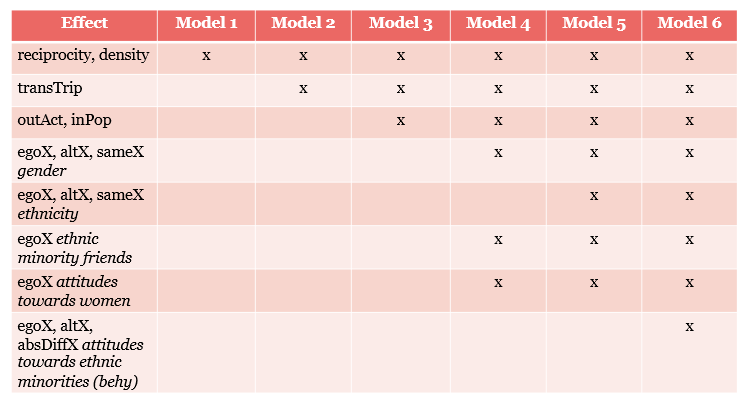

<br>

**Figure 2**

*Model specifications - Behavioral model*

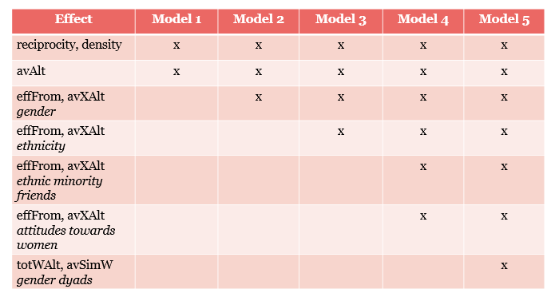

<br>

As displayed in the table above, I included a number of effects to test my hypotheses. I elaborate on these effects below. First, to account for homophily effects on the network level, I added covariate-ego (*egoX*), covariate-alter (*altX*), and same-covariate (*sameX*) effects. These were modelled for both gender and ethnicity, to test whether students are more likely to send a tie when they themselves are male/female or Dutch/non-Dutch (*egoX*); when a classmate is of a certain gender or ethnicity (*altX*); or when they and their classmate share the same gender or ethnicity (*sameX*). I did the same for primary outgroup attitudes and the number of ethnic minority friends. The effects are respectively defined in the RSiena manual (Ripley et al., 2026) as follows:

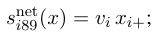

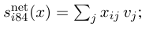

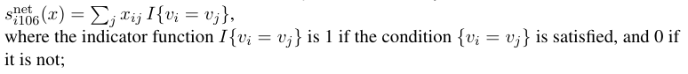

<br>

Finally, to account for **selection effects** or feedback mechanisms, I again included egoX and altX, as well as an absolute covariate-difference effect (*absDiffX*). The function is defined by Ripley et al. (2026) below. Here, the network is predicted by the behavioral dependent (i.e. ethnic minority attitudes). Specifically, these effects test whether students are more llikely to become friends with others based on their ethnic minority attitudes and how much they are like themselves.

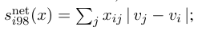

<br>

On the behavioral level, I first included an average alter effect (*avAlt*), which examines the tendency of students to adapt their ethnic minority attitudes to the average of their friends.

Next, I added a main covariate effect (*effFrom)* for gender and ethnicity, which is similar to the egoX effect in the network model. This effect shows whether the gender and ethnicity of students themselves affect their ethnic minority attitudes. I also included an alter's covariate average effect (*avXAlt*) for gender and ethnicity, which is defined as follows:

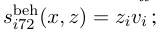

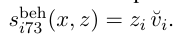

Next, to take into account the effects of primary outgroup friends (i.e. based on gender) on the development of secondary outgroup (i.e. ethnic minority) attitudes, I included two effects, which I interacted with a dyadic covariate which specifies outgroup friendship based on gender (see section 'Covariates' \> 'Dyadic'). In doing so, I followed effects documentation of Bracegirdle et al. 2021 and Zingora et al. 2026.

First, I included alter’s total of dyadic covariate W effect on behavior z (*totWAlt)*. When interacted with the dyadic covariate, this effect specifies the tendency for actors with more primary outgroup (i.e. gender) friends to develop more positive attitudes towards a secondary outgroup (i.e. ethnic minorities).

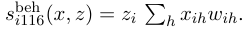

Second, I included an effect for the average similarity weighted by dyadic covariate W (*avSimW)*. This effect represents the tendency for actors to adopt an average secondary outgroup (i.e. ethnic minority) attitude of their primary outgroup (i.e. gender) friends (cf. Bracegirdle et al. 2021).

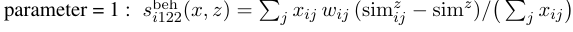

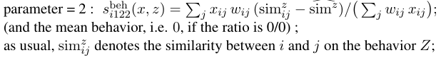

<br>

------------------------------------------------------------------------

# References

<br>

Bracegirdle, C., Reimer, N. K., Van Zalk, M., Hewstone, M., & Wölfer, R. (2021). Disentangling contact and socialization effects on outgroup attitudes in diverse friendship networks. *Journal of Personality and Social Psychology*, *122*(1), 1–15. <https://doi.org/10.1037/pspa0000240>

Centraal Bureau voor de Statistiek. (n.d.). *Migratieachtergrond*. Centraal Bureau Voor De Statistiek. <https://www.cbs.nl/nl-nl/onze-diensten/methoden/begrippen/migratieachtergrond>

Krause, R. W., Huisman, M., & Snijders, T. A. B. (2018). Multiple imputation for longitudinal network data. *Statistica Applicata - Italian Journal of Applied Statistics*, *30*(1), 33–57. <https://doi.org/10.26398/ijas.0030-002>

Ripley, R., Snijders, T. A. B., Boda, Z. & Vörös, A. (2026). Manual for RSiena. R package version 1.6.6. <https://www.stats.ox.ac.uk/~snijders/siena/RSiena_Manual.pdf>

Simpson, C. R. (2022). Social support and network formation in a small-scale horticulturalist population. *Scientific Data*, *9*(570), 1–20. <https://doi.org/10.1038/s41597-022-01516-x>

Snijders, T. A. B., Ripley, R. M., Boitmanis, K., Steglich, C., Niezink, N. M. D., Schoenenberger, F., Amati, V. & Gotthardt, D. (2026). RSiena - Simulation Investigation for Empirical Network Analysis, R package version 1.6.6. <https://www.stats.ox.ac.uk/~snijders/siena>

Snijders, T. A. B., & Steglich, C. E. G. (2013). Representing micro–macro linkages by actor-based dynamic network models. *Sociological Methods & Research*, *44*(2), 222–271. <https://doi.org/10.1177/0049124113494573>

Tolsma, J., & Hofstra, B. (2024). *Social Network Analysis for Social Scientists*. <https://snass.netlify.app/>

Tolsma, J., & Pop, I. (2010). *The Nijmegen School Study Wave 2010*. Radboud University. <https://ssh.datastations.nl/dataset.xhtml?persistentId=doi:10.17026/DANS-ZWC-DUCR>

Zingora, T., Bracegirdle, C., Stark, T. H., & Spiegler, O. (2026). Outgroup friendships and social influence in the development of adolescent attitudes toward secondary outgroups. *Journal of Personality and Social Psychology*, *131*(3), 444–462. <https://doi.org/10.1037/pspi0000530>
