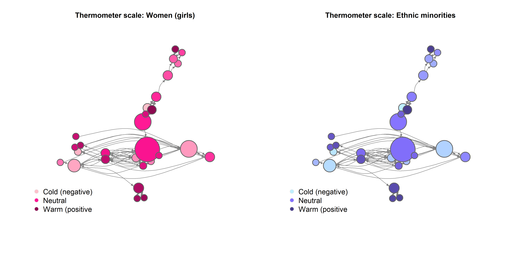
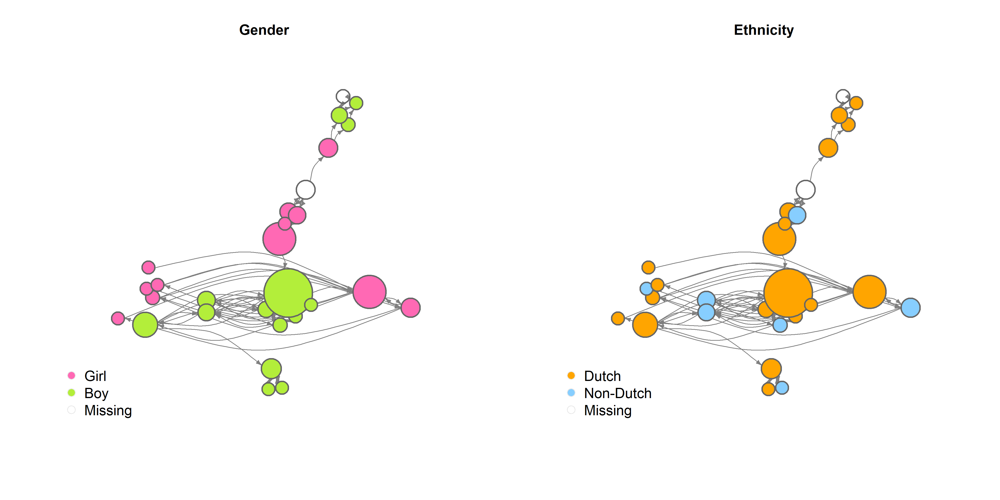
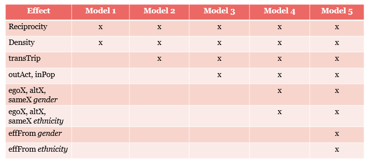

```{r setup, include=FALSE}
knitr::opts_chunk$set(echo = TRUE)
```

<br>

# Data and Methods

<br>

## Data

To answer the research questions, I used social network data from The Nijmegen School Study (TNSS, see codebook by Tolsma & Pop, 2010). The data were collected in 2010 and 2011 among students in Nijmegen, the Netherlands. Data collection was focused on bullying, friendships, and prejudice among students in secondary education. All first- and second-year students registered at Mondial College, location Lindenholt, Nijmegen, Netherlands "were invited to participate in the study (384 potential respondents in 8 first year classes and 7 second year classes). The mentors of the classes were also invited to fill in a supplementary questionnaire", supplying the network and bullying nomination data. A total of 364 students, from **13 (check?)** classes, participated in the data collection (94.8% response rate), and 14 mentors (93.3%) completed the supplementary questionnaire.

-   Ik heb 1 klas eruit gekozen voor analyse. Deze klas heeft 28 leerlingen, waarvan 2 missings hebben op [wat??]. Het netwerk dat ik analyseer bestaat dus uit N=28. Directed network.

TNSS consists of two waves, the first of which was collected in April 2010 and contains both student and mentor (i.e. network) data. Data collection of the second wave took place between April and May 2011. In storage, the network / mentor nomination data has been lost to time, which means that only the student (i.e. background / survey) data is available for this second wave.

Practically, this means that the social network data only consists of one wave, and is therefore cross-sectional rather than longitudinal. Seeing as this departs from the standard approach in social network analysis - which uses longitudinal data - the current data will be analyzed using a stationary Stochastic Actor-Oriented Model (SAOM), or short-term dynamic equilibrium (see Snijders & Steglich, 2013). This means that the network at wave 1 will be used as the network at wave 2 as well. "the observed network is used as the starting as well as the ending observation, as a reflection of the equilibrium concept” (Simpson, 2022). “Put simply, “[cross-sectional] SAOMs assume that the network structure, although changing, is in a stochastically stable state.” (Krause, Huisman, and Snijders, p. 36–37). Thus, the estimated parameters β continue to summarise the rules by which ministeps unfold. However, the asynchronous, sequential, simulated tie changes, in a sense, “cancel out” and thus hold the network in “short-term dynamic equilibrium” (Simpson, 2022).

For more details about model specification, see the section 'Analytical strategy' below.

<br>

### Dependent variables

#### *Network: Friendships*

Friendship networks between students were assessed through the supplementary questionnaire given to class mentors. This means that nomination data were not obtained by students themselves, but as observed by their mentor. The friendship network of the particular class that was analyzed is visually displayed below. *[Color/shape is based on gender/ethnicity, and x is based on outgroup attitudes (either girls or ethnic minorities)].* The network is relatively sparse (i.e. few ties between nodes) and contains a few very central students. There are no isolates.

(Note: this network structure could partially be explained by the mentor nomination data.)

*[insert figuur visualisatie]*

<br>

#### *Behavior: Ethnic minority attitudes*

In addition to a network dependent variable, I also estimate a behavioral dependent. In this case, I use ethnic minority attitudes. Linking back to the theory on intergroup contact and transfer effects, we need to define a primary and secondary outgroup. The TNSS data contain multiple measures about attitudes based on both gender and ethnicity, which is why these outgroups were chosen. Gender was used as the primary outgroup, meaning that the secondary outgroup is based on ethnicity. For the behavioral Y, I used a thermometer measure from TNSS indicating ethnic minority attitudes. Respondents were given the following introduction: "There are different groups of people living in the Netherlands. Of course, Dutch people live there. There are also ethnic minorities in the Netherlands. Like for example Turkish Dutch people (Turks), Moroccan Dutch people (Moroccans), Surinamese Dutch people (Surinamese) and many more. These groups are called ethnic minorities. Please answer the following questions about ethnic minorities in the Netherlands." The thermometer scale question was asked as follows: "Please use the following thermometer to show what you think about ethnic minorities in the Netherlands", showing a line ranging from "cold (negative), 0" on the left, to "warm (positive), 100" on the right. (Please note that all items were translated to English by the author from the original Dutch questionnaire).

```{r}

```

<br>

### Covariates

#### *Monadic*

I used **ethnicity** and **gender** of students and their friends as constant (i.e. not time-varying) covariates. Both were directly asked of respondents and were coded or recoded in a binary way (boy or girl; Dutch or non-Dutch / migration background). Gender was asked via: "I am a... [boy / girl]". For ethnicity, I used a set of questions asking where the respondent was born, as well as their mother and father. Answer options were: "The Netherlands", "Türkiye", "Morocco", "Suriname", "Dutch Antilles / Aruba", and "other, namely....". When one or more of these questions were answered with a country different from the Netherlands, a respondent was coded as having a migration background (cf. CBS, bron).

```{r}

```

I also controlled for the **number of ethnic minority friends**, and **primary outgroup attitudes**, i.e. a thermometer measure indicating attitudes towards women. The former was asked through an open question: "How many of your good friends in your school class are an ethnic minority? Like for example Turkish Dutch, Moroccan Dutch, or other groups." The latter was asked using a similar thermometer scale as before: "Please use the following thermometer to show what you think about women (girls)", again ranging from "cold (negative), 0" to "warm (positive), 100".

<br>

#### *Dyadic*

In addition to monadic (i.e. individual, actor-based) covariates, I also included dyadic variables to map outgroup friendship. I manually constructed matrices where friendships between students with different genders were coded as 1, and same-gender friendships were coded as 0. This way, I created a dyadic covariate that represents **outgroup friendships based on gender** (following Bracegirdle et al. 2026).

<br>

#### *Control variables*

Finally, I included a number of control variables to account for structural network effects. I included reciprocity, density, transitivity (transTrip), in-degree popularity, and out-degree activity. All covariates were added to the statistical models in a stepwise and cumulative manner. See the figure below for my full model specifications.

<br>

## Analytical strategy

First, I conducted some descriptive analyses to get a feel for the data and for first insights. See the web page 'Descriptive results' in the top navigation bar for visualization of the network and descriptive statistics.

Following the descriptives, I estimated Stochastic Actor-Oriented Models (SAOMs) using the R package RSiena [@RSiena]. SAOMs use an actor-based approach to simulate network evolution processes based on micro decisions. Specifically, it relies on the ministep assumption, stating that all observable network changes are the result of the smallest possible steps; i.e. one actor making one decision (making, breaking, or maintaining a tie). *"SAOMs model network evolution over time by simulating probabilistic changes in ties based on specified network statistics, which function as independent variables. RSiena distinguishes between structural effects (network-level tendencies, e.g., reciprocity, popularity, or triadic closure) and covariate effects (node characteristics, e.g., gender, prestige)." (Mylène)*

As described above, I use cross-sectional network data, meaning that I can not use the usual longitudinal SAOM approach. Instead, my analysis is based on a "short-term dynamic equilibrium" or stationary SAOM approach (as described by Snijders & Steglich, 2013). Again, the observed network is used both as the starting and ending observation, reflecting the equilibrium concept. "Put simply, “[cross-sectional] SAOMs assume that the network structure, although changing, is in a stochastically stable state.” (Krause, Huisman, and Snijders, p. 36–37). Thus, the estimated parameters β continue to summarise the rules by which ministeps unfold. However, the asynchronous, sequential, simulated tie changes, in a sense, “cancel out” and thus hold the network in “short-term dynamic equilibrium” (Simpson, 2022). Concretely, this means that I used the network data on wave 1 as input for 'wave 2' (which is identical, except for one random tie change). To make sure the actors are able to make ministeps between these two time points, the rate parameter has to be fixed in a short-term dynamic equilibrium approach; to a "high but not too high value" (Simpson, 2022; Snijders & Steglich, 2013). Snijders & Steglich recommend an average value of λ = 20, which I followed. I also tried some robustness checks, fixing the rate parameter at lower (λ = 5) or higher (λ = 50) values.

<br>

### *Model specification*

Defining the effects structure in RSiena consists of an iterative and cumulative process of adding effects one at a time (cf. Ripley et al. 2026; Snijders & Steglich, 2013). Models are built up with increasing complexity, starting from a simple model containing only structural network effects, and working up to more complex effects. Once a model with all desired effects has converged, I employ Goodness of Fit (GOF) tests to see whether the model accurately represents the observed network based on some auxiliary statistics (see 'RSiena results' page). New effects are then added to better fit the model to the observed outcomes.

I followed this stepwise procedure, as recommended by the RSiena authors; starting with reciprocity and density (Model 01), followed by a transitive triplets effect (Model 02), indegree popularity and outdegree activity (Model 03), and homophily effects for gender (Model 04) and ethnicity (Model 05). Because of convergence issues, I started with fitting a model on the network dependent variable only, and later added effects for the behavioral Y as well. It is important to note that, to my knowledge, there have not been any studies that have applied the stationary (one-wave) SAOM approach to behavioral outcomes. My model specifications therefore consisted of quite some trial and error and have turned out simpler than first planned (i.e. I could not include all effects due to convergence issues). I also ended up fixing the rate parameter for the behavioral dependent variable, since it kept being estimated to unrealistically high values, and thereby substantially contributed to convergence issues. See the figure below for my model specifications.

-   plaatje modelopbouw



<br>

As displayed in the table above, I included a number of effects to test my hypotheses. First, to account for homophily effects on the network level, I added covariate-ego (*egoX*), covariate-alter (*altX*), and same-covariate (*sameX*) effects. These were modelled for both gender and ethnicity, to test whether xxxxx. The effects are defined in the RSiena manual (Ripley et al., 2026) as follows:


<br>

On the behavioral level, I first included a main covariate effect (*effFrom)* to account for xxxxx.


Next, to examine **social influence** I need to include effects that take into account the effects of primary outgroup friends (i.e. based on gender) on the development of secondary outgroup (i.e. ethnic minority) attitudes. I included two effects, which I interacted with a dyadic covariate which specifies outgroup friendship based on gender (see section 'Covariates' \> 'Dyadic'). In doing so, I followed effects documentation of Bracegirdle et al. 2022 and Zingora et al. 2026.

First, I included alter’s total of dyadic covariate W effect on behavior z (*totWAlt)*. When interacted with the dyadic covariate, this effect specifies the tendency for actors with more [outgroup gender] friends to develop more positive attitudes towards a secondary outgroup [ethnic minorities].


Second, I included an effect for the average similarity weighted by dyadic covariate W (*avSimW)*. This effect represents the tendency for actors to adopt an average [ethnic minority] attitude of their [outgroup gender] friends (cf. Bracegirdle et al. 2022).


<br>

Finally, to account for **selection effects** or feedback mechanisms, I included xxxx. Here, the network is predicted by the behavioral dependent (i.e. ethnic minority attitudes).

<br>

------------------------------------------------------------------------

# References

<br>
