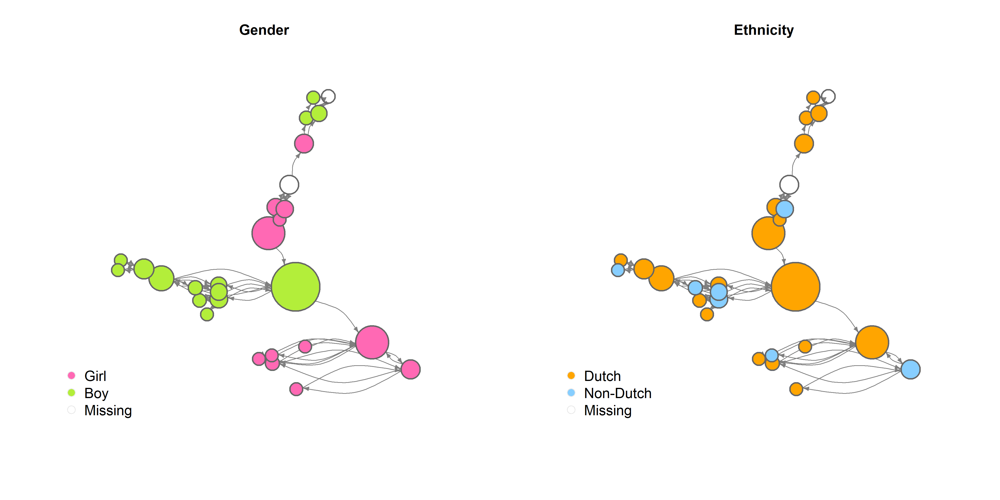
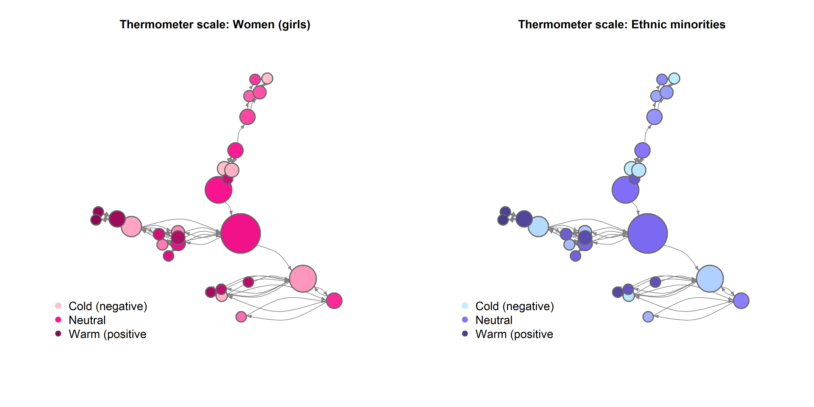

```{r setup, include=FALSE}
knitr::opts_chunk$set(warning = FALSE, message = FALSE, echo = TRUE) 
```

<br>

# Descriptive results

<br>

In this chapter, I visually and numerically describe my sample and network. Below, you can find the descriptives and my interpretations, as well as the corresponding R code.

<br>

## *Loading and preparing data*

```{r}
rm(list = ls()) # clean workspace

# custom functions
fpackage.check <- function(packages) {
    lapply(packages, FUN = function(x) {
        if (!require(x, character.only = TRUE)) {
            install.packages(x, dependencies = TRUE)
            library(x, character.only = TRUE)
        }
    })
}

fsave <- function(x, file = NULL, location = "./data/") {
    ifelse(!dir.exists("data"), dir.create("data"), FALSE)
    ifelse(!dir.exists("data"), dir.create("data"), FALSE)
    if (is.null(file))
        file = deparse(substitute(x))
    datename <- substr(gsub("[:-]", "", Sys.time()), 1, 8)
    totalname <- paste(location, datename, file, ".rda", sep = "")
    save(x, file = totalname)  #need to fix if file is reloaded as input name, not as x. 
}

fload <- function(filename) {
    load(filename)
    get(ls()[ls() != "filename"])
}

fshowdf <- function(x, ...) {
    knitr::kable(x, digits = 2, "html", ...) %>%
        kableExtra::kable_styling(bootstrap_options = c("striped", "hover")) %>%
        kableExtra::scroll_box(width = "100%", height = "300px")
}

packages = c("RSiena", "tidyverse", "stringdist", "stringi")

fpackage.check(packages)

# NETWORK DEPENDENT ---------------------------------------------------------------
library(haven)
tnss_net <- read_sav("./data/TNSS_wave_2010_mentors.sav")
tnss_pup10 <- read_sav("./data/TNSS_wave_2010_pupils.sav")
tnss_pup11 <- read_sav("./data/TNSS_wave_2011_pupils.sav")
# using 'foreign' I got warnings and didn't seem to load well. 'haven' works nicely

view(tnss_net)
view(tnss_pup10)
view(tnss_pup11) # all looks good

class(tnss_net) # tibble/data frame
class(tnss_pup10)
class(tnss_pup11)

#join datasets
# gaat automatisch goed gelukkig (obv IDClass en IDresp)
tnss <- left_join(tnss_net, tnss_pup10)
# view(tnss)

tnss_pup10 <- tnss_pup10 %>% 
  rownames_to_column(var = "id") 

tnss_pup11 <- tnss_pup11 %>% 
  rownames_to_column(var = "id") 

tnss_2waves <- left_join(tnss_pup10, tnss_pup11, by=c("id"))
# view(tnss_2waves)
tnss_2waves_c5 <- tnss_2waves %>%
  filter(IDClass == 5)
view(tnss_2waves_c5)

#select class 5 (big class with few missings)
c5 <- tnss %>% 
  filter(IDClass == 5)

# for exploratory purposes, I also looked at class 3. But did not end up using this in my analyses
c3 <- tnss %>% 
  filter(IDClass == 3)

#aantal leerlingen in class 5
max(c5$order) # 28
max(c3$order) # 27

#vis het nominatienetwerk er uit. Nu beetje handwerk. Kan vast slimmer. 
c5_net <- c5 %>%
  select(fr_1:fr_28)
c3_net <- c3 %>%
  select(fr_1:fr_27)
# view(c5_net)
class(c5_net) # tibble/data frame
# view(c3_net)

net <- as.matrix(c5_net)
sum(diag(net) != 0)

view(c5_net)
length(c5_net)

net2 <- net

net2[1,2] <- 1


# BEHAVIORAL DEPENDENT ------------------------------------------------------------
id <- c5 %>% 
  dplyr::select("IDresp")

# choosing which specific measure of EM attitudes I will use
library(car)
# hist(tnss_2waves$comfyEM)
# hist(tnss_2waves$comfyEM_2)
# densityPlot(tnss_2waves$thermo_minority)
# densityPlot(tnss_2waves$thermo_minority_2)

behy_pre <- tnss_2waves %>% 
  filter(IDresp.x %in% c5$IDresp) %>% 
  dplyr::select("IDresp.x", "thermo_minority", "thermo_minority_2") %>% 
  as.matrix() %>% 
  data.frame

id <- left_join(id, behy_pre, by=join_by(IDresp == IDresp.x) )

behy_nosiena_matrix <- id %>% dplyr::select("thermo_minority", "thermo_minority_2") %>% 
  as.matrix()

behy_nosiena <- id %>% dplyr::select("thermo_minority", "thermo_minority_2") 
class(behy_nosiena$thermo_minority)

behy_nosiena %>% 
  mutate(thermo_minority_cat = case_when(
    `thermo_minority` > 0 & `thermo_minority`< 11 ~ "1-10",
    `thermo_minority` > 10 & `thermo_minority`< 21 ~ "11-20",
    `thermo_minority` > 20 & `thermo_minority`< 31 ~ "21-30",
    `thermo_minority` > 30 & `thermo_minority`< 41 ~ "31-40",
    `thermo_minority` > 40 & `thermo_minority`< 51 ~ "41-50",
    `thermo_minority` > 50 & `thermo_minority`< 61 ~ "51-60",
    `thermo_minority` > 60 & `thermo_minority`< 71 ~ "61-70",
    `thermo_minority` > 70 & `thermo_minority`< 81 ~ "71-80",
    `thermo_minority` > 80 & `thermo_minority`< 91 ~ "81-90",
    `thermo_minority` > 90 & `thermo_minority`< 101 ~ "91-100",
  ))

behy_nosiena %>% 
  mutate(thermo_minority_cat2 = case_when(
    `thermo_minority_2` > 0 & `thermo_minority_2`< 11 ~ "1-10",
    `thermo_minority_2` > 10 & `thermo_minority_2`< 21 ~ "11-20",
    `thermo_minority_2` > 20 & `thermo_minority_2`< 31 ~ "21-30",
    `thermo_minority_2` > 30 & `thermo_minority_2`< 41 ~ "31-40",
    `thermo_minority_2` > 40 & `thermo_minority_2`< 51 ~ "41-50",
    `thermo_minority_2` > 50 & `thermo_minority_2`< 61 ~ "51-60",
    `thermo_minority_2` > 60 & `thermo_minority_2`< 71 ~ "61-70",
    `thermo_minority_2` > 70 & `thermo_minority_2`< 81 ~ "71-80",
    `thermo_minority_2` > 80 & `thermo_minority_2`< 91 ~ "81-90",
    `thermo_minority_2` > 90 & `thermo_minority_2`< 101 ~ "91-100",
  ))

behy_nosiena
```

<br>

## *Descriptive statistics*

### Sample description

The entire TNSS sample consists of 49.7% boys and 50.3% girls, and 85.7% of students are Dutch, compared to 14.3% from various other backgrounds. In terms of the behavioral measure, the average level of ethnic minority attitudes is 61.5 in wave 1 and 60.3 in wave 2, indicating neutral to slightly more warm/positive attitudes. In the full sample, there is also a slight decline in ethnic minority attitudes between the waves.

In the specific class that I use for the analyses, the values of these descriptives are similar. The distribution of boys and girls is again quite equal, but this class contains relatively a bit more boys (53.8% boys, 46.2% girls). Relative to the school, this class contains more students with migration backgrounds (73.1% Dutch, 26.9% ethnic minorities). The level of ethnic minority attitudes is interestingly a bit lower in this class compared to the school average (mean in wave 1 = 55.1, and in wave 2 = 59.2). There is also an increase between the two waves, in contrast with the school average again.

```{r}
# SAMPLE DESCRIPTION
summary(tnss_pup10)

# frequencies
hist(tnss_pup10$gender)
table <- table(tnss_pup10$gender)
prob_table <- table / sum(table)
print(prob_table) # 49.7% boys, 50.3% girls

hist(c5$gender)
table_c5 <- table(c5$gender)
prob_table_c5 <- table_c5 / sum(table_c5)
print(prob_table_c5) # 53.8% boys, 46.2% girls

library(car)
densityPlot(tnss_pup10$ethnicity)
table1 <- table(tnss_pup10$ethnicity)
prob_table1 <- table1 / sum(table1)
print(prob_table1) # 85.7% Dutch, 14.3% from various other backgrounds

table1_c5 <- table(c5$ethnicity)
prob_table1_c5 <- table1_c5 / sum(table1_c5)
print(prob_table1_c5) # 73.1% Dutch

# behavioral Y (wave 1 and 2)
densityPlot(tnss_pup10$thermo_minority) 
summary(tnss_pup10$thermo_minority) # mean = 61.5 (bit more leaning towards warm), median = 63. Two peaks at 50 and 80, very slightly negatively skewed.
sd(tnss_pup10$thermo_minority) #23.6
hist(behy_pre$thermo_minority) # unimodal, normally distributed and peak is at 50
summary(behy_pre$thermo_minority) # mean = 55.1, relatively low for the school

densityPlot(tnss_pup11$thermo_minority_2) 
summary(tnss_pup11$thermo_minority_2) # mean = 60.6, median = 60; slightly lower. Distribution in density plot does seem different though. Again seems multimodal, but peak is clearly at 50 (halfway point), slightly negatively skewed.
sd(tnss_pup11$thermo_minority_2) 
densityPlot(behy_pre$thermo_minority_2) # unimodal, normally distributed and peak is at 50. Bit more positively skewed though, somewhat of a peak at 80 as well.
summary(behy_pre$thermo_minority_2) # mean = 59.2, still relatively low for the school, but increase from wave 1 (interesting compared to school average)
```

<br>

### Network description

Below, you find a general description of the friendship network. Again: note that this is not self-nominated data, but observed by mentors. And also note that I use a one-wave network, so all descriptives concern wave 1. In contrast with the behavioral measure, I can not make comparisons between the network at wave 1 and 2.

As seen in the descriptives below, the friendship network in this particular class consists of 28 actors, who in total have 82 ties between them. The network is unimodal (i.e. only one type/level of actors), directed (i.e. directional from one actor to another) and not weighted (i.e. friendship ties are binary: 0-1, instead of continuous scales of more/less friends).

Further, I looked at reciprocity, density, transitivity, and the dyad and triad censuses in the network (Hofstra & Tolsma, 2024). There is a total of 68 reciprocated ties, and (based on the dyad census) the number of pairs with mutual connections is 34; the number of pairs with non-mutual connections is 14; and finally there are 330 pairs with no ties between them. The overall level of **reciprocity** in the network is 0.83, meaning that 83% of all outgoing ties are reciprocated (Tolsma & Hofstra, 2024). The level of **density** in the network is 0.11, which is a relatively low value for classrooms (as also reflected in the visualizations below). Concretely, this value means that 11% of all possible ties are observed in the network (Tolsma & Hofstra, 2024). Again, this could have to do with the type of nomination data; since friendships were observed by mentors and hence perhaps not all underlying ties were mapped. In terms of the **triad census**, the most occuring triad was the 003, or in other words, a triad in which none of the actors have ties between them (Tolsma & Hofstra, 2024). The next most common was the 102 (which indicates one reciprocated tie between two actors), followed by the 012 (reflecting one outgoing tie from one actor to another).

```{r}
require(igraph)
g1 <- graph_from_adjacency_matrix(net)
g2 <- graph_from_adjacency_matrix(net2) # only for the behavioral Y, since the network is virtually the same
g1a <- graph_from_adjacency_matrix(as.matrix(c3_net)) # to inspect data for another school class

vcount(g1) # count vertices / actors #28
ecount(g1) # count edges / ties #82
is_bipartite(g1) # is the network unimodal or multi? # F
is_weighted(g1) # F

gmat <- as_adjacency_matrix(g1, type = "both", sparse = FALSE)
isSymmetric(gmat) # F, dus directed

require(RsienaTwoStep)
# reciprocity
ts_recip(g1) # 68
reciprocity(g1, ignore.loops = TRUE, mode = c("default", "ratio")) # 0.83, high!

#in- and outdegree
ts_outAct(g1) # 6724
ts_inAct(g1) # same number
indeg <- igraph::degree(g1, mode = "in")
summary(indeg) # on average students received 3 friendship nominations
outdeg <- igraph::degree(g1, mode = "out")
summary(outdeg) # and 'sent' 2.9 friendship ties

triad_census(g1)
dyad_census(g1)
# $mut = number of pairs with mutual connections #34
# $asym = number of pairs with non-mutual connections #14
# $null = number of pairs with no connections between them #330

# transivitity
igraph::transitivity(g1, type = c("localundirected"), isolates = c("NaN", "zero"))

# betweenness
igraph::betweenness(g1, directed = T)

# density
igraph::edge_density(g1) # 0.11
```

<br>

#### **Moran's I**

Finally, I inspected Moran's I as an indicator for network segregation on the macro level. Moran's I is a spatial autocorrelation measure, showing whether people who are closer to each other in a network are more alike (Tolsma & Hofstra, 2024). I used the function ape::Moran.I for the calculation, which uses row-standardization by default. Theoretically, this method assumes that each actor is influenced equally by its neighborhood regardless of how large it is (Tolsma & Hofstra, 2024). In that regard, it is similar to an average alter effect in RSiena.

The results show no significant level of segregation based on ethnic minority attitudes; the observed network does not differ significantly from an expected network with no segregation. Instead of being segregated, ethnic minority attitudes seem to vary throughout the network. After this initial calculation, I estimated Moran's I again using a distance decay function, meaning that alters that are further removed from ego are weighed less in the calculation. Using this method, there is some evidence for segregation, as the observed network significantly differs from the expected network without segregation (*p* = .001). Interestingly, the results thus show that students do seem more alike to their direct neighbors in terms of ethnic minority attitudes, but this is not the case for classmates further apart from them. These results show mixed preliminary support for H5.

```{r}
require(ape)
require(sna)
geodistances <- geodist(net, count.paths = TRUE)
geodistances <- geodistances$gdist

weights1 <- geodistances == 1

# this function rowstandardizes by default!
# wave 1
ape::Moran.I(behy_nosiena$thermo_minority, scaled = FALSE, weight = weights1, na.rm = TRUE)
# observed = -0.22, expected = -0.04, SE = 0.15, p = 0.23

# wave 2
ape::Moran.I(behy_nosiena$thermo_minority_2, scaled = FALSE, weight = weights1, na.rm = TRUE)
# observed = -0.07 expected = -0.04, SE = 0.16, p = 0.84

# in both waves no segregation

# now with a distance decay function = ties further apart are weighed less
weights2 <- exp(-geodistances)
# wave 1
ape::Moran.I(behy_nosiena$thermo_minority, scaled = FALSE, weight = weights2, na.rm = TRUE) # observed differs significantly from expected! p = 0.002

# wave 2
ape::Moran.I(behy_nosiena$thermo_minority_2, scaled = FALSE, weight = weights2, na.rm = TRUE) # same here
```

------------------------------------------------------------------------

<br>

## *Network visualization*

Below, you find two graphs visualizing the social network. Figure 3 describes the gender (left) and ethnicity (right) of students. The color of the nodes is based on the gender or ethnicity (see legend), and the size of the nodes is based on a betweenness score. I used an algorithm for the layout and manually placed certain nodes further apart to highlight clustering. In Figure 4, attitudes towards primary (women/girls, left) and secondary outgroups (ethnic minorities, right) are displayed. Again, size of the nodes is based on betweenness score. The color of the nodes represents students' attitudes, and is a gradient based on their value on the thermometer scale. A darker shade symbolizes a higher thermometer score and thus more positive attitudes. The same fixed layout for nodes was used for comparability between plots.

As seen in both figures, the network is highly clustered and consists of very distinct friend groups rather than one interconnected classroom (again, note the mentor nomination data). Highlighted in Figure 3, the class network seems very much clustered based on gender. In terms of ethnicity, the clusters look more mixed, with Dutch and non-Dutch students having mixed friend groups. In the network there are a couple of students with really high levels of betweenness (as visible in the node size), which seem literally at the center of the classroom network. These students connect the different clusters at the periphery of the network and act as brokers or bridges between different friend groups (see Burt, 2005). In particular, there is one very popular central actor, who is male and has a Dutch background. As reflected in Figure 4, this student has quite neutral attitudes when it comes to both primary and secondary outgroups.

<br>

**Figure 3**

*Gender and ethnicity of TNSS students, wave 1*

```{r}

```

*Note*. Source: The Nijmegen School Study (Tolsma & Pop, 2010). Nodes were manually and algorithmically (using Fruchterman-Reingold layout) placed further apart, to highlight clustering in the network.

<br>

As seen in Figure 4, primary and secondary outgroup attitudes in the class network seem quite diverse. The clustering in the network does not seem based on these attitudes. In general, students seem pretty consistent in their outgroup attitudes; people who score high on one outgroup also seem to have positive attitudes towards the other. This could reflect a sense of overall tolerance which, which provides some preliminary support for H1. Interestingly, the most central actors seem neutral or even negative in their attitudes towards both women and ethnic minorities. There are certain students who seem more tolerant (positive) towards both groups, and one cluster in particular that is very positive towards both outgroups.

<br>

**Figure 4**

*Primary and secondary outgroup attitudes of TNSS students, wave 1*

```{r}

```

*Note*. Source: The Nijmegen School Study (Tolsma & Pop, 2010). Nodes were manually and algorithmically (using Fruchterman-Reingold layout) placed further apart, to highlight clustering in the network.

<br>

```{r}
#kleur op basis van gender. staat in goede volgorde. 
V(g1)$color <- ifelse(c5$gender == 1, "red", "green")
# plot(g1)

# GENDER AND ETHNICITY OF STUDENTS (T1)
layoutfr <- layout_with_fr(g1)
layoutfr[15,1] <- 3
layoutfr[16,1] <- -1
layoutfr[3,1] <- -4
layoutfr[22,1] <- -1
layoutfr[4,1] <- 7
layoutfr[12,1] <- 9

V(g1)$size = igraph::betweenness(g1) * 0.2 + 9
V(g2)$size = igraph::betweenness(g1) * 0.2 + 9

{png("plot1.png", width = 14, height = 7, units = "in", res = 300)

par(mfrow = c(1, 2))

plot(g1,
     vertex.color = ifelse(c5$gender == 1, "hotpink", "olivedrab2"),
     vertex.frame.color = "gray40",
     vertex.frame.width = 2,
     vertex.label = NA, 
     edge.curved = 0.4,
     edge.arrow.size = 0.4,
     edge.color = "gray50",
     layout = layoutfr, 
     main = "Gender")

legend("bottomleft", c("Girl", "Boy", "Missing"), pch = 21, col = "grey91", pt.bg = c("hotpink", "olivedrab2", "white"), pt.cex = 1.5, cex = 1.2, bty = "n", ncol = 1)

plot(g1,
     vertex.color = ifelse(c5$ethnicity == 1, "orange", "skyblue1"),
     vertex.frame.color = "gray40",
     vertex.frame.width = 2,
     vertex.label = NA,
     edge.curved = 0.4,
     edge.arrow.size = 0.4,
     edge.color = "gray50",
     layout = layoutfr, 
     main = "Ethnicity")

legend("bottomleft", c("Dutch", "Non-Dutch", "Missing"), pch = 21, col = "grey91", pt.bg = c("orange", "skyblue1", "white"), pt.cex = 1.5, cex = 1.2, bty = "n", ncol = 1)

dev.off()}


# PRIMARY AND SECONDARY OUTGROUP ATTITUDES

# first create a gradient for the attitude thermometers
# women at t1
my_palette_w <- colorRampPalette(c("pink", "deeppink1", "deeppink4"))
attitudew1 <- tnss_2waves_c5$thermo_vrouwen
attitudew1_color <- my_palette_w(length(attitudew1))

# t2
attitudew2 <- tnss_2waves_c5$thermo_vrouwen_2
attitudew2_color <- my_palette_w(length(attitudew2))

# plot t1 and t2 attitudes first for primary outgroup attitudes
{png("plot_gender.png", width = 14, height = 7, units = "in", res = 300)

par(mfrow = c(1, 2))

plot(g1,
     vertex.color = attitudew1_color,
     vertex.frame.color = "gray40",
     vertex.frame.width = 2,
     vertex.label = NA, 
     edge.curved = 0.4,
     edge.arrow.size = 0.4,
     edge.color = "gray50",
     layout = layoutfr, 
     main = "Thermometer scale: Women (girls) - Wave 1")

legend("bottomleft", c("Cold (negative)", "Neutral", "Warm (positive"), pch = 21, col = "grey91", pt.bg = c("pink", "deeppink1", "deeppink4"), pt.cex = 1.5, cex = 1.2, bty = "n", ncol = 1)

plot(g2,
     vertex.color = attitudew2_color,
     vertex.frame.color = "gray40",
     vertex.frame.width = 2,
     vertex.label = NA,
     edge.curved = 0.4,
     edge.arrow.size = 0.4,
     edge.color = "gray50",
     layout = layoutfr, 
     main = "Thermometer scale: Women (girls) - Wave 2")

legend("bottomleft", c("Cold (negative)", "Neutral", "Warm (positive"), pch = 21, col = "grey91", pt.bg = c("pink", "deeppink1", "deeppink4"), pt.cex = 1.5, cex = 1.2, bty = "n", ncol = 1)

dev.off()}


# ethnic minorities at t1
my_palette_em <- colorRampPalette(c("lightblue1", "lightslateblue", "darkslateblue"))
attitudeem1 <- tnss_2waves_c5$thermo_minority
attitudeem1_color <- my_palette_em(length(attitudeem1))

#t2
attitudeem2 <- tnss_2waves_c5$thermo_minority_2
attitudeem2_color <- my_palette_em(length(attitudeem2))

mean(tnss_2waves_c5$thermo_minority) # 55.08
mean(tnss_2waves_c5$thermo_minority_2) # 59.2

# still use size based on betweenness

# plot t1 and t2 attitudes first for primary outgroup attitudes
{png("plot_ethnic.png", width = 14, height = 7, units = "in", res = 300)

par(mfrow = c(1, 2))

plot(g1,
     vertex.color = attitudeem1_color,
     vertex.frame.color = "gray40",
     vertex.frame.width = 2,
     vertex.label = NA, 
     edge.curved = 0.4,
     edge.arrow.size = 0.4,
     edge.color = "gray50",
     layout = layoutfr, 
     main = "Thermometer scale: Ethnic minorities - Wave 1")

legend("bottomleft", c("Cold (negative)", "Neutral", "Warm (positive"), pch = 21, col = "grey91", pt.bg = c("lightblue1", "lightslateblue", "darkslateblue"), pt.cex = 1.5, cex = 1.2, bty = "n", ncol = 1)

plot(g2,
     vertex.color = attitudeem2_color,
     vertex.frame.color = "gray40",
     vertex.frame.width = 2,
     vertex.label = NA,
     edge.curved = 0.4,
     edge.arrow.size = 0.4,
     edge.color = "gray50",
     layout = layoutfr, 
     main = "Thermometer scale: Ethnic minorities - Wave 2")

legend("bottomleft", c("Cold (negative)", "Neutral", "Warm (positive"), pch = 21, col = "grey91", pt.bg = c("lightblue1", "lightslateblue", "darkslateblue"), pt.cex = 1.5, cex = 1.2, bty = "n", ncol = 1)

dev.off()}


# now plot as one image
# one image with primary and secondary outgroup attitudes at t1
{png("plot2.png", width = 14, height = 7, units = "in", res = 300)

par(mfrow = c(1, 2))

plot(g1,
     vertex.color = attitudew1_color,
     vertex.frame.color = "gray40",
     vertex.frame.width = 2,
     vertex.label = NA, 
     edge.curved = 0.4,
     edge.arrow.size = 0.4,
     edge.color = "gray50",
     layout = layoutfr, 
     main = "Thermometer scale: Women (girls)")

legend("bottomleft", c("Cold (negative)", "Neutral", "Warm (positive"), pch = 21, col = "grey91", pt.bg = c("pink", "deeppink1", "deeppink4"), pt.cex = 1.5, cex = 1.2, bty = "n", ncol = 1)

plot(g1,
     vertex.color = attitudeem1_color,
     vertex.frame.color = "gray40",
     vertex.frame.width = 2,
     vertex.label = NA,
     edge.curved = 0.4,
     edge.arrow.size = 0.4,
     edge.color = "gray50",
     layout = layoutfr, 
     main = "Thermometer scale: Ethnic minorities")

legend("bottomleft", c("Cold (negative)", "Neutral", "Warm (positive"), pch = 21, col = "grey91", pt.bg = c("lightblue1", "lightslateblue", "darkslateblue"), pt.cex = 1.5, cex = 1.2, bty = "n", ncol = 1)

dev.off()}
```

------------------------------------------------------------------------

## References

<br>

Burt, R. S. (2005). *Brokerage and closure: An introduction to social capital*. Oxford University Press. 

Tolsma, J., & Hofstra, B. (2024). Social Network Analysis for Social Scientists. <https://snass.netlify.app/>
