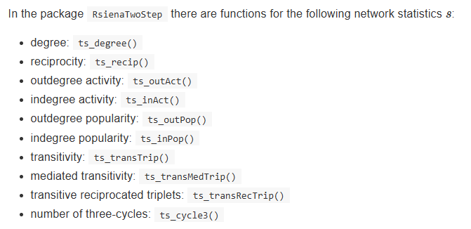

```{r setup, include=FALSE}
knitr::opts_chunk$set(echo = TRUE)
```

<br>

# Workshop 07-09-2026

<br>

## *Summary*

In the workshop we did the following:

-   Student presentations on first ideas RQs and literature

-   Ashwin presentation on his data

-   Started figuring out some descriptive statistics

## *Current to-do list*

-   Update my RQs and prepare presentation for next time

    -   Start writing introduction

    -   Think about data

-   Read chapter 6 (and scan 8) of SNASS

-   Continue figuring out the descriptives

-   Update lab journal and website

<br>

------------------------------------------------------------------------

# Lab Journal

<br>

## Installing and prepping packages

```{r}
# install.packages("RSiena")
# install.packages("igraph")
# install.packages("styler")
# install.packages("network")
library(RSiena)
library(igraph)
library(network)
```

## Descriptive statistics

More info here: <https://rpubs.com/bunnificent/862631>

```{r}
# the data
s501
?s501
summary(s501)
str(s501)
attributes(s501)
rm(list = ls())

network(s501)
 summary(s501,
          print.adj = TRUE
          )
 
 flo.stat<-
        network(
        s501,
        directed=F,
        matrix.type="adjacency"
        )

?igraph
require(igraph)
graph <- graph_from_adjacency_matrix(s501, mode = "directed")
graph

vcount(graph) # count vertices / actors
ecount(graph) # count edges / ties
is_bipartite(graph) # is the network unimodal or multi?
is_weighted(graph) # are edges weigthed or unweighted?

# EGO CHARACTERISTICS -------------------------------------------------------
# indegrees, outdegrees, skewness van distributions

# ts_degree(net = options[[1]], ego = ego) # number of ties ego sends to alters = outdegrees
# lapply(options, ts_recip, ego = ego) # number of reciprocated ties


# DYADS / TRIADS ------------------------------------------------------------
# dyad and triad census
?triad_census
triad_census(graph)

?dyad_census
dyad_census(graph)
# $mut = number of pairs with mutual connections = 39
# $asym = number of pairs with non-mutual connections = 35
# $null = number of pairs with no connections between them = 1151

# PATH LENGTH
# calculate for each path length the proportion of nodes each node can reach and take the average value of that
mean((ego_size(graph, order = 2, mode = "out") - 1)/vcount(graph)) # 0.0944
# path length is set to 2 here
```



## Moran's I

From @SNASS Chapter 6

```{r}
# RQ: Is the network segregated based on drinking behavior?

# OPTION 1: WITH PACKAGE 'SNA'
# install.packages("sna")
require(RSiena)
library(network)
friend.data.w1 <- s501
friend.data.w2 <- s502
friend.data.w3 <- s503
drink <- s50a
smoke <- s50s

net1 <- network::as.network(friend.data.w1)
net2 <- network::as.network(friend.data.w2)
net3 <- network::as.network(friend.data.w3)

# nacf does not row standardize!
snam1 <- sna::nacf(net1, drink[, 1], type = "moran", neighborhood.type = "out", demean = TRUE)
snam1[2]  #the first order matrix is stored in second list-element
# Moran's I = 0.433


# OPTION 2: WITH PACKAGE 'APE'
# install.packages("ape")
require(ape)
require(sna)
geodistances <- geodist(net1, count.paths = TRUE)
geodistances <- geodistances$gdist

# first define a nb based on distance 1.
weights1 <- geodistances == 1

# this function rowstandardizes by default
ape::Moran.I(drink[, 1], scaled = FALSE, weight = weights1, na.rm = TRUE)
# Moran's I = 0.486


# OPTION 3: JOCHEM'S OWN FUNCTION
# without rowstandardize
fMoran.I <- function(x, weight, scaled = FALSE, na.rm = FALSE, alternative = "two.sided", rowstandardize = TRUE) {
    if (rowstandardize) {
        if (dim(weight)[1] != dim(weight)[2])
            stop("'weight' must be a square matrix")
        n <- length(x)
        if (dim(weight)[1] != n)
            stop("'weight' must have as many rows as observations in 'x'")
        ei <- -1/(n - 1)
        nas <- is.na(x)
        if (any(nas)) {
            if (na.rm) {
                x <- x[!nas]
                n <- length(x)
                weight <- weight[!nas, !nas]
            } else {
                warning("'x' has missing values: maybe you wanted to set na.rm = TRUE?")
                return(list(observed = NA, expected = ei, sd = NA, p.value = NA))
            }
        }
        ROWSUM <- rowSums(weight)
        ROWSUM[ROWSUM == 0] <- 1
        weight <- weight/ROWSUM
        s <- sum(weight)
        m <- mean(x)
        y <- x - m
        cv <- sum(weight * y %o% y)
        v <- sum(y^2)
        obs <- (n/s) * (cv/v)
        if (scaled) {
            i.max <- (n/s) * (sd(rowSums(weight) * y)/sqrt(v/(n - 1)))
            obs <- obs/i.max
        }
        S1 <- 0.5 * sum((weight + t(weight))^2)
        S2 <- sum((apply(weight, 1, sum) + apply(weight, 2, sum))^2)
        s.sq <- s^2
        k <- (sum(y^4)/n)/(v/n)^2
        sdi <- sqrt((n * ((n^2 - 3 * n + 3) * S1 - n * S2 + 3 * s.sq) - k * (n * (n - 1) * S1 - 2 * n *
            S2 + 6 * s.sq))/((n - 1) * (n - 2) * (n - 3) * s.sq) - 1/((n - 1)^2))
        alternative <- match.arg(alternative, c("two.sided", "less", "greater"))
        pv <- pnorm(obs, mean = ei, sd = sdi)
        if (alternative == "two.sided")
            pv <- if (obs <= ei)
                2 * pv else 2 * (1 - pv)
        if (alternative == "greater")
            pv <- 1 - pv
        list(observed = obs, expected = ei, sd = sdi, p.value = pv)
    } else {
        if (dim(weight)[1] != dim(weight)[2])
            stop("'weight' must be a square matrix")
        n <- length(x)
        if (dim(weight)[1] != n)
            stop("'weight' must have as many rows as observations in 'x'")
        ei <- -1/(n - 1)
        nas <- is.na(x)
        if (any(nas)) {
            if (na.rm) {
                x <- x[!nas]
                n <- length(x)
                weight <- weight[!nas, !nas]
            } else {
                warning("'x' has missing values: maybe you wanted to set na.rm = TRUE?")
                return(list(observed = NA, expected = ei, sd = NA, p.value = NA))
            }
        }
        # ROWSUM <- rowSums(weight) ROWSUM[ROWSUM == 0] <- 1 weight <- weight/ROWSUM
        s <- sum(weight)
        m <- mean(x)
        y <- x - m
        cv <- sum(weight * y %o% y)
        v <- sum(y^2)
        obs <- (n/s) * (cv/v)
        if (scaled) {
            i.max <- (n/s) * (sd(rowSums(weight) * y)/sqrt(v/(n - 1)))
            obs <- obs/i.max
        }
        S1 <- 0.5 * sum((weight + t(weight))^2)
        S2 <- sum((apply(weight, 1, sum) + apply(weight, 2, sum))^2)
        s.sq <- s^2
        k <- (sum(y^4)/n)/(v/n)^2
        sdi <- sqrt((n * ((n^2 - 3 * n + 3) * S1 - n * S2 + 3 * s.sq) - k * (n * (n - 1) * S1 - 2 * n *
            S2 + 6 * s.sq))/((n - 1) * (n - 2) * (n - 3) * s.sq) - 1/((n - 1)^2))
        alternative <- match.arg(alternative, c("two.sided", "less", "greater"))
        pv <- pnorm(obs, mean = ei, sd = sdi)
        if (alternative == "two.sided")
            pv <- if (obs <= ei)
                2 * pv else 2 * (1 - pv)
        if (alternative == "greater")
            pv <- 1 - pv
        list(observed = obs, expected = ei, sd = sdi, p.value = pv)
    }


}

fMoran.I(drink[, 1], scaled = FALSE, weight = weights1, na.rm = TRUE, rowstandardize = FALSE)
# Moran's I = 0.4331
# same result as nacf function (in option 1)


# Finally, calculate a correlation where connected actors further away from i weigh less

# step 1: calculate distances
geodistances <- geodist(net1, count.paths = TRUE)
geodistances <- geodistances$gdist
# set the distance to yourself as Inf
diag(geodistances) <- Inf


# step 2: define a distance decay function. This one is pretty standard in the spatial autocorrelation literature but actually pretty arbitrary.
weights2 <- exp(-geodistances)

# step 3: I dont want to rowstandardize.
fMoran.I(drink[, 1], scaled = FALSE, weight = weights2, na.rm = TRUE, rowstandardize = FALSE)

# Corr = 0.281
# Conclusion: yes, pupils closer to one another are more alike! And ‘closer’ here means a shorter path length. You also observe that the correlation is lower than we calculated previously. Apparently, we are similar to alters very close by (path length one) and less so (or even dissimilar) to alters further off.
```

------------------------------------------------------------------------

<br>

# Introduction

<br>

## *RQs and ideas*

**Micro X**: attitudes of primary out-group friends toward secondary out-group

**Micro Y**: attitudes of ego toward secondary out-group

**Macro Y**: distribution of secondary out-group attitudes / secondary out-group friendships in the network

-   From ethnic minority perspective?

-   Or completely different type of out-group, not related to ethnicity?

**RQ1**: What is the distribution of secondary out-group attitudes / friendships in the network?

**RQ2**: To what extent are secondary out-group attitudes / friendships explained by social influence effects (rather than secondary transfer effects of intergroup contact)?

<br>

## *First draft introduction*

First (rough) draft of my introduction, 11-09-2026

-   Intergroup contact theory is one of the most established theories in contemporary Sociology (Allport, 1954; Pettigrew & Tropp); If people have more contact with out-group members, they are more likely to develop positive attitudes on this out-group (**member? checken**) as well. 

-   Over time, the theoretical model has been extended to include all out-group members (bron), and even members of other out-groups that were not directly involved in the contact at all. The latter is known as a secondary transfer effect of intergroup contact (Pettigrew, 2009), and has been tested / studied extensively. 

    -   But: conditional → when the secondary out-group is similar in culture, stigma, status (= generalization gradient effect)

    -   Growing bodies of research on indirect contact (**extended**=simply knowing an in-group member has out-group friend, Zhou et al., 2018; **vicarious**=observing other in-group members, online, reading stories) - see Tropp et al., 2022; Stark et al., 2025

    -   Experimental research even shows support for secondary transfer effects when contact with the primary group was merely observed or even imagined (Harwood et al., 2011; Vezzali et al., 2014)

-   The most important underlying mechanism seems to be attitude generalization (Tausch et al., 2010), where [uitleg].... However, contacts with the secondary out-group can also predict attitudes towards the primary out-group. And more importantly, maybe this represents truly a selection effect where more tolerant people become friends with a range of out-group members. This raises an important question:

    -   “Given this complex, bidirectional nature of the contact and prejudice relationship, we must focus on this problem: Do primary contact effects typically generalize to other, noncontacted out-groups? Or does the secondary transfer effect largely reflect the nonrecursive phenomenon whereby more tolerant people engage in more intergroup contact generally and harbor less prejudice against a wide variety of outgroups?” (Pettigrew, 2009, p. 56).

    -   In other (social network) words: selection or influence?

    -   Longitudinal data + social network data!

-   Another important factor remains understudied: The social embeddedness and interdependence of people engaged in this contact. The secondary out-group friendship formation may depend on individual out-group attitudes, but may also depend on opportunity structures, existing relations, having friends in common, or structural network effects, such as reciprocity, transitivity, or clustering. To disentangle [xxx], social network data can form an important addition to the literature on secondary transfer of intergroup contact. 

    -   Results from social network analysis on extended contact support this: extended contact reduces prejudice only when some of the outgroup friends of one’s ingroup friends are known → so: only in mixed triads, not in open triads (Stark, 2019)

    -   Wölfer et al. 2017

    -   “How social networks shape opportunities to form intergroup friendships, influence intergroup attitudes, and affect ongoing intergroup interactions and relationships. This emerging work reveals how friendships across group lines are shaped not only by the individuals involved but also by their other friends, the attitudes of those around them, and the structure and context of their broader social network” (Turetsky & Shelton, 2024)

-   So: is this secondary transfer effect of intergroup contact actually because of generalization, or could it actually (partially) reflect network dynamics, such as social influence? (cf. Zingora et al. 2026)

    -   Recent studies say: it’s actually fully influence, not transfer.

        -   Zingora 2025 –\> meta-analysis of SOAM studies

        -   “Friendships with primary outgroup members may have negative implications for secondary outgroups when those friends hold more negative attitudes” (Zingora et al., 2026).

        -   Having outgroup friends was not linked to more positive intergroup attitudes once social influence (i.e., ingroup friends’ attitudes) was accounted for (for a meta-analysis, see Zingora, 2025).

    -   The importance of social influence is further demonstrated by Bracegirdle et al. 2026: “Socialization was strongest among friends who held initially opposing attitudes, which led both high- and low-prejudice individuals to become more neutral over time. The findings thus suggest that socialization has a neutralizing effect, rather than a polarizing effect”

        -   **Big conclusion** = Friends’ out-group attitudes become more similar to each other. If the friends are negative: you will become more negative (and vice versa).

-   Social influence in this context has the strongest effects when friends have initially opposing attitudes:\
    “What mattered most was not whether adolescents or their friends held positive or negative views, but the size of the initial difference between them. Change in adolescents’ attitudes was largest when attitudes were opposed (e.g., positive vs. negative), smaller when one was neutral, and minimal when they were similar” (Zingora et al. 2026)

-   Secondary transfer effects are not always found → social influence can help explain this; who influences who? (is it all kinds of friends, or just in- or out-group friends?)

    -   “Some studies reported social influence from ingroup but not from outgroup friends (Bracegirdle et al., 2023), implying that having outgroup friends is not associated with outgroup attitudes. Others found influence of outgroup friends’ attitudes on generalized prejudice (Zingora & Flache, 2025).”

    -   Most recent research shows → people’s attitudes to secondary outgroups changed not due to having friends from the primary outgroup but due to the attitudes that those primary outgroup friends hold toward secondary outgroups **!!!**

-   Data / context justification:

    -   Schools are shown to play an important role in stimulating positive contact between (ethnic) groups, both within and outside of the school environment (Karataş et al., 2023). → offering a secure environment with the facilitative conditions (see Allport; Pettigrew & Tropp). Can be transferred or ‘spilled over’ into other contexts

    -   “In addition, schools also bring together young people from diverse ethnic and cultural backgrounds and are, therefore,also an important acculturative context (Schachneret al., 2018).”

    -   “Intergroup contact is often proposed as one of the main strategies for curbing these undesirable outcomes and enhancing the development of inclusive attitudes, especially among adolescents (Tropp et al., 2022; Wölfer et al., 2016)”

    -   “We focused on interethnic friendships during adolescence because adolescents’ attitudes toward ethnic outgroups are more malleable than adults’ attitudes (Wölfer et al., 2016) and because adolescents are especially motivated to adopt the attitudes of significant peers and friends (Brechwald & Prinstein, 2011; Steinberg & Monahan, 2007).”

-   “By bridging insights from intergroup contact theory and social network analysis, our research offers a novel perspective on attitude change in multicultural environments.” (Zingora et al. 2026)

<br>

## *First ideas on data*

Necessary components:

-   adolescents in school classes

-   longitudinal

-   3 types of groups (in-group, primary out, secondary out-group)

    -   at least 2 different outgroups

-   attitudes on all these 3 groups / friendships

From available options:

-   **FIS data** → 1/2/3 generation migrants (but maybe too in-group-y?) / social class / religion / intergroup attitudes and contact / acculturation and *perceived discrimination*

    -   Possibly extend logic of social influence effects to perceived discrimination?

    -   Some literature: <https://doi.org/10.1177/21568693241271289>, <https://doi.org/10.1037/pspi0000426>, <https://link.springer.com/article/10.1007/s10964-023-01746-1>

    -   But: a LOT less literature + it would mean to drop the secondary group thing

-   **MRCS data** → Salience of social identity elements

    -   Intergroup contact attitudes (broad!) \> "people of other social identities"

-   **The Arnhem School Study (TASS)** → Geen toegang tot codeboek online (<https://ssh.datastations.nl/dataset.xhtml?persistentId=doi:10.17026/DANS-ZC6-JHDK>) –\> via Jochem?

-   **The Nijmegen School Study (TNSS)**

    -   Vooroordelen en positief/negatief contact obv etniciteit en gender

        -   O.a. thermometerschalen, percentages, ook contact ouders

    -   'Hoeveel van je goede vrienden zijn x?' –\> is dit genoeg (compleet) netwerkdata?

        -   Matrix lijkt alleen over pesten, ingevuld door mentoren

        -   Pesten dan als behavioral DV nemen?
